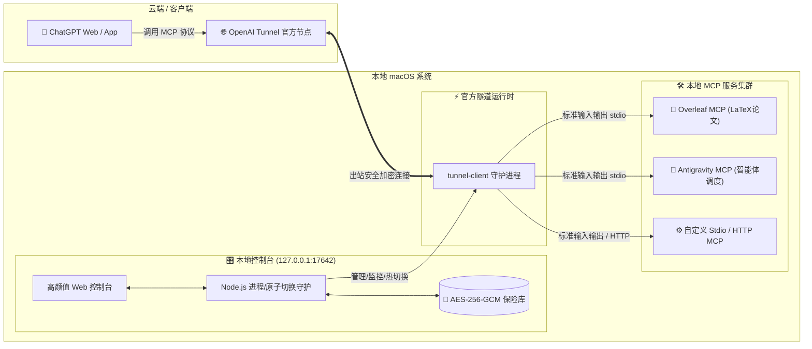

# 🚀 MCP Tunnel Account Manager

<div align="center">

**专为 macOS & Windows 打造的高颜值、零依赖、本地优先的 OpenAI Secure MCP 隧道与多账号协同管理控制台**

[%20%7C%20Windows-blue.svg?logo=apple&logoColor=white)](https://github.com/diaohuaian/mcp-tunnel-account-manager)
[-green.svg?logo=node.js)](https://nodejs.org)
[](https://github.com/diaohuaian/mcp-tunnel-account-manager)
[-success.svg?logo=github-actions)](https://github.com/diaohuaian/mcp-tunnel-account-manager)
[](https://github.com/diaohuaian/mcp-tunnel-account-manager/stargazers)

<br/>

让 **ChatGPT** 通过 **OpenAI Secure MCP Tunnel** 丝滑、安全地直连你的本地 MCP 服务（**Overleaf 论文协同**、**Antigravity 智能体 IDE**、**DeepSeek** 等），支持多账号一键原子切换与自动健康回滚！

<br/>


</div>

---

## ✨ 为什么选择 MCP Tunnel Account Manager？

在 Mac 上使用 ChatGPT 连接本地 MCP 工具时，常常面临**复杂的配置文件调试**、**进程意外退出导致连接断开**、**多套隧道凭证切换繁琐**等痛点。

本项目为你提供一整套现代化、高可靠的开箱即用解决方案：

### 🍏 深度优化 macOS 原生体验
- **彻底告别 PowerShell 依赖**：全套采用纯 Node.js 现代异步架构实现进程控制与生命周期管理，完美支持 **macOS（Apple Silicon M1/M2/M3/M4 与 Intel 芯片）**。
- **一键桌面原生 App（含专属 Retina 霓虹图标）**：双击即可后台无感拉起管理器并在系统默认浏览器中唤起控制台，无需常驻打开黑框终端。
- **macOS 原生目录集成**：配置与加密数据库安全存储在 `~/Library/Application Support/McpTunnelAccountManager`，支持通过 Finder 一键定位配置文件。

### ⚡ 零第三方运行依赖（Zero Dependencies）
- 充分发挥现代 Node.js（>= 22.14.0）原生能力，内置 `node:sqlite`（零 C++ 编译风险）、`node:crypto`、原生 WebSocket 与进程控制。
- **无需漫长的 `npm install`**，克隆代码即可秒级启动！

### 🔒 本地加密保险库（Local-First Security）
- **高强度军工级加密**：所有 API Key、Tunnel ID 及敏感环境变量均通过持久化 **AES-256-GCM** 主密钥加密存储于本地 SQLite 数据库中。
- **严格权限隔离**：主密钥与凭证文件强制实施 `0600` 权限（仅当前系统用户可读写）。
- **零网络外泄风险**：管理服务严格绑定并监听 `127.0.0.1` 本机回环地址，拒绝外网暴露与跨域风险。

### 🛡️ 5 步原子级热切换与全自动回滚（Atomic Transaction & Auto Rollback）
- 支持多套账号配置（Profile）管理与一键切换。
- 执行流程：`排队中 (QUEUED)` $\to$ `准备中 (PREPARING)` $\to$ `应用中 (APPLYING)` $\to$ `校验中 (VERIFYING)` $\to$ `生效 (SUCCEEDED)`。
- **故障零残留**：在校验阶段若检测到进程启动失败或端口身份不符，**立即触发自动化回滚 (`ROLLED_BACK`)**，自动恢复原配置与运行状态，彻底杜绝配置漂移与服务崩溃。

### 📦 完善的开箱即用 MCP 生态集成
- 内置 **OpenAI 官方 `tunnel-client`** 架构自适应安装套件（自动识别 Apple Silicon `arm64` 与 Intel `amd64`）。
- 内置 **Overleaf MCP** 自动化安装套件（支持 LaTeX 论文 AI 读写、审阅批注、语法对比与本地编译）。
- 内置 **Antigravity MCP** 调度套件（连接本地 Antigravity 智能体引擎调度能力）。

---

## 🏗️ 架构与交互流程



---

## ⚡ 30 秒极速上手指南（macOS）

### 1. 确认系统环境
确保系统已安装 Node.js 22.14.0+ 与 Git（若未安装，推荐通过 Homebrew 一键安装）：
```bash
brew install node git
```

### 2. 克隆项目
```bash
git clone https://github.com/diaohuaian/mcp-tunnel-account-manager.git
cd mcp-tunnel-account-manager
```

### 3. 一键创建桌面启动 App（推荐 🌟）
运行以下脚本，即可在你的 Mac 桌面上生成带高清图标的独立应用程序：
```bash
./Install-Desktop-Shortcut.sh
```
> 🎉 **安装完成后**：直接在桌面双击 **「MCP Tunnel 账户管理器.app」**，后台服务将自动唤起，并在默认浏览器中秒开控制台！

*(或者通过终端直接启动：`./start-manager.sh`)*

---

## 🛠️ 配套组件一键安装工具

本项目在 `scripts/` 目录下准备了专为 macOS 打造的一键依赖部署脚本：

### 1. 一键安装 OpenAI 官方 `tunnel-client`
```bash
./scripts/install-tunnel-client.sh
```
- 自动识别 Apple Silicon (`darwin-arm64`) 或 Intel (`darwin-amd64`)。
- 自动从 OpenAI 官方仓库安全获取二进制文件、解除 macOS Gatekeeper 隔离并配置环境。

### 2. 一键安装 Overleaf MCP 服务
```bash
./scripts/install-overleaf-mcp.sh
```
- 部署 `mcp-server-overleaf` 运行时。
- 配合控制台即可在 ChatGPT 中使用自然语言完成 LaTeX 论文阅读、公式推导、修改与推送。

### 3. 一键安装 Antigravity MCP 服务
```bash
./scripts/install-antigravity-mcp.sh
```
- 一键克隆并配置 [Antigravity MCP](https://github.com/Kio-pon/antigravity-mcp) 启动入口。

---

## 💻 常用运维指令

| 操作 | 命令 | 说明 |
| :--- | :--- | :--- |
| **启动后台服务** | `./start-manager.sh` | 默认启动在 `http://127.0.0.1:17642` 并自动打开浏览器 |
| **停止后台服务** | `./start-manager.sh --stop` | 安全停止当前运行的管理器守护进程 |
| **前台调试模式** | `./start-manager.sh --foreground` | 实时查看日志与标准输出 |
| **自定义端口** | `./start-manager.sh --port 18000` | 灵活指定监听端口 |
| **运行完整测试** | `npm test` | 执行全套 44 个单元与集成测试用例 |

---

## 🔒 隐私与安全性规范

1. **零数据上报**：本项目不包含任何遥测、埋点、统计或第三方追踪代码。
2. **凭据安全隔离**：用户初始化的主密码、Token 及生成的密钥完全保存在本机 `~/Library/Application Support/McpTunnelAccountManager`，代码仓库永远不含任何私密数据。
3. **网络安全防护**：内置严格的 CSRF 保护、会话时效校验与幂等性令牌（Idempotency-Key）。

---

## 🤝 贡献与反馈

欢迎提交 Issue 和 Pull Request 来完善 macOS 与其他平台的体验！

1. Fork 本仓库并创建特性分支 (`git checkout -b feat/amazing-feature`)
2. 提交代码变更 (`git commit -m 'feat: Add some amazing feature'`)
3. 确保所有测试通过 (`npm test`)
4. 推送到你的分支 (`git push origin feat/amazing-feature`)
5. 开启一个 Pull Request

---

## 🌟 欢迎点赞 Star 支持！

如果你觉得这个项目帮你在 Mac 上更优雅地玩转 **ChatGPT + MCP 协同工作流**，请顺手给仓库点个 **⭐️ Star**！你的支持是持续维护和优化的最大动力！

<div align="center">

[](https://github.com/diaohuaian/mcp-tunnel-account-manager)

</div>
