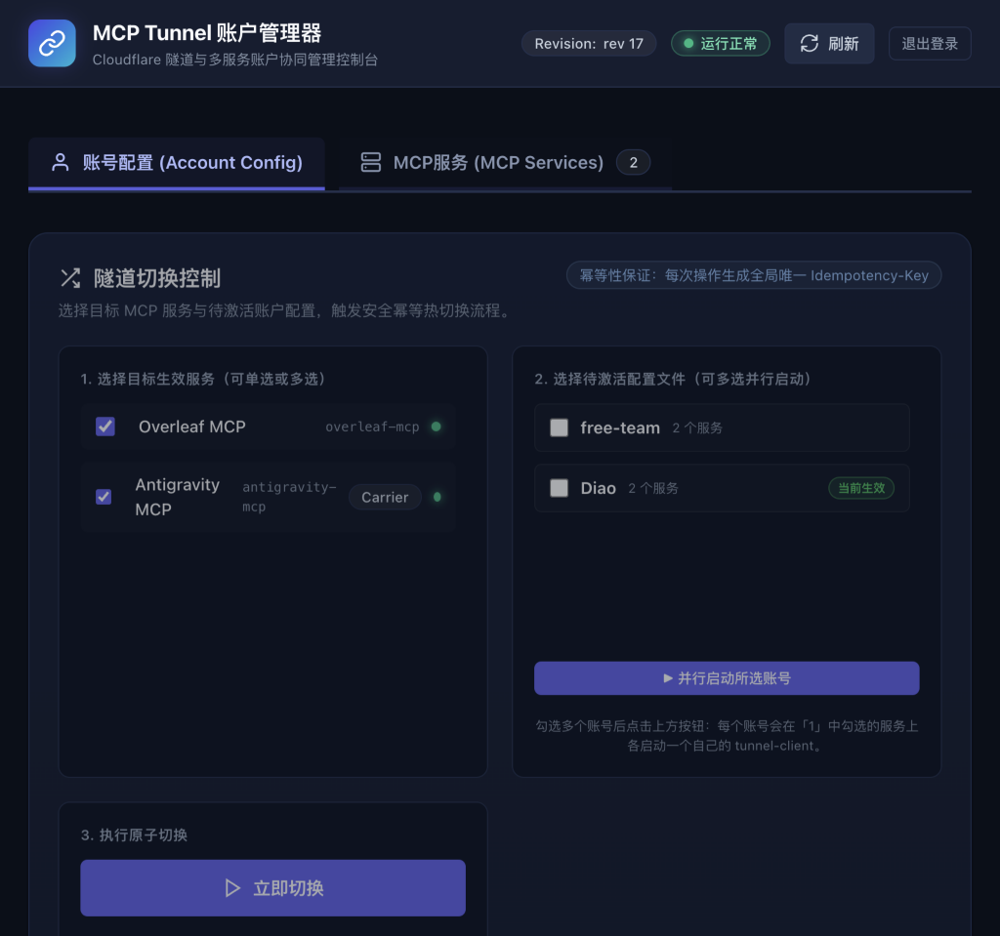

<div align="center">

# 🚀 MCP Tunnel Account Manager

### 跨平台（macOS / Windows）多账号 · 多 MCP 本地管理与并发控制台

[](https://github.com/diaohuaian/mcp-tunnel-account-manager/stargazers)
[](https://github.com/diaohuaian/mcp-tunnel-account-manager/network/members)
[](https://github.com/diaohuaian/mcp-tunnel-account-manager)
[-success?style=for-the-badge&logo=vitest&logoColor=white)](scripts/run-tests.mjs)
[-success?style=for-the-badge&logo=node.js&logoColor=white)](package.json)
[](src/vault.mjs)

<p align="center">
  <b><a href="#-亮点特性">功能亮点</a></b> •
  <b><a href="#-快速开始-macos">macOS 快速上手</a></b> •
  <b><a href="#-快速开始-windows">Windows 快速上手</a></b> •
  <b><a href="#-技术架构解析">架构与跨平台核心</a></b> •
  <b><a href="#-常见问题与故障排查">常见问题</a></b> •
  <b><a href="README_EN.md">English Documentation</a></b>
</p>

> 💡 **如果这个项目解决了你在 macOS 或 Windows 上管理 MCP 隧道多账号与自动化进程调度的痛点，请不吝点亮右上角 ⭐ Star 和 🍴 Fork 支持！**

---



</div>

---

## 🌟 为什么需要它？

在深度使用 Model Context Protocol (MCP) 与 OpenAI Tunnel Client 的日常研发中，痛点往往集中在：
- **多账号与多环境频繁切换**：个人账号、团队账号、测试账号的 Tunnel ID、API Key、配置文件散落在终端和各处 YAML 中，极易混淆或覆盖。
- **macOS / Linux 缺乏原生生态支持**：官方方案与社区早期实现严重深度绑定 Windows PowerShell、`cmd.exe` 与注册表，在 macOS 上举步维艰（频繁报 `spawn powershell ENOENT`、`$HOME is not defined`、路径转义错误）。
- **多服务并发运行困难**：多个 MCP（如 Overleaf 写作、Antigravity Agent、自定义 HTTP/Stdio 服务）并行拉起时缺乏集中生命周期监控，容易出现僵尸进程、端口占用或资源竞争崩溃。
- **故障排查繁琐**：隧道掉线或鉴权过期难以察觉，缺乏自动探测、自愈重连与安全锁定保护。

**MCP Tunnel Account Manager** 彻底解决了上述问题：提供一个**纯本地、零外部 npm 依赖、全图形化**的管理控制台，让多账号配置保存、无感秒级切换、多实例并发调度与健康监护变得前所未有的轻快与安全。

---

## ✨ 亮点特性

### 🍏 原生 macOS 深度适配
- **无 PowerShell 依赖**：纯 Node.js 精准实现底层系统调用，完美替代 Windows 脚本引擎，在 macOS 上原生支持 `Inspect`、`Verify`、`Stop`、`Launch` 等进程原子控制动作。
- **标准系统规范**：遵循 macOS 文件系统约定（`~/Library/Application Support`），自动处理 `/var` 符号链接与 Unix 环境变量隔离。
- **开箱即用桌面体验**：提供一键安装脚本 `Install-Desktop-Shortcut.sh`，直接在「桌面」与「应用程序」生成原生 macOS App 图标，双击即启！

### 🛡️ 企业级本地安全架构
- **物理落盘加密**：所有敏感凭据（Tunnel ID、OpenAI API Key 等）均经由 AES-256-GCM 配合本地主密钥及 AAD 防篡改校验封装，杜绝明文泄露。
- **严格安全环回**：Web 控制台严格限定监听 `127.0.0.1` 环回接口，禁止外部网络越权访问；配有 CSRF 令牌保护与管理员密码安全认证。
- **安全恢复闸门 (Recovery Gate)**：独创原子 CAS（Compare-And-Swap）配置校验机制与安全闸门系统，一旦检测到不可预期的环境漂移或进程失联，立即自动锁定并提供一键安全自愈重置。

### ⚡ 强大的多实例与多 MCP 并发能力
- **秒级账号切换**：保存命名账号配置文件（如 `Work-Team`, `Personal`, `Diao` 等），下拉菜单中一键即可热切换全部关联服务，毫秒级重启生效。
- **多 MCP 并发运行**：不仅支持经典的 `Overleaf MCP` 与 `Antigravity MCP`，还支持通过网页自由添加、编辑自定义的任意 **Stdio** 或 **HTTP** 协议 MCP 服务。
- **智能资源调度 (ResourcePolicy)**：深度适配 macOS `vm_stat` 活跃/非活跃内存统计机制，智能准入与并发配额控制，彻底杜绝多隧道并发拉起时的系统资源枯竭。

---

## 🚀 快速开始 (macOS)

### 1. 环境准备
- **macOS**：macOS Ventura (13+), Sonoma (14+), Sequoia (15+) 均可（Apple Silicon M1/M2/M3/M4 & Intel x86_64）
- **Node.js**：`>= 22.14.0`（推荐通过 [brew](https://brew.sh) 或 [fnm/nvm] 安装：`brew install node`）
- **Git**

### 2. 克隆项目与安装
```bash
# 克隆仓库
git clone https://github.com/diaohuaian/mcp-tunnel-account-manager.git
cd mcp-tunnel-account-manager

# 赋予执行权限
chmod +x *.sh *.command bin/*
```

### 3. 一键启动

我们为你准备了三种极简启动方式（任选其一即可）：

#### 方式 A：生成 macOS 桌面应用程序（最推荐）
```bash
./Install-Desktop-Shortcut.sh
```
执行后你的桌面上会立刻生成 **`MCP Tunnel 账户管理器.app`**。双击即可后台拉起守护进程并自动在默认浏览器中打开控制台！

#### 方式 B：双击脚本启动
双击项目根目录下的 **`Start-Console.command`** 即可直接启动并打开浏览器。

#### 方式 C：终端命令行启动
```bash
# 后台守护进程启动（推荐）
./start-manager.sh

# 或查看启动帮助 / 前台运行
./start-manager.sh --foreground
```

打开浏览器访问：**`http://127.0.0.1:17642`**

> 🔑 **首次初始化**：
> 首次启动时控制台会提示输入引导码（Bootstrap Code）。引导码保存在本地：
> `~/Library/Application Support/McpTunnelAccountManager/bootstrap-code.txt`
> 输入后即可为控制台设置你的管理员密码。

#### 停止控制台服务
```bash
./start-manager.sh --stop
```

---

## 🖥️ 快速开始 (Windows)

1. 环境要求：Windows 10 / 11 x64，Node.js >= 22.14.0。
2. 双击运行 **`Install-Components.cmd`** 安装组件。
3. 双击运行 **`Start-Console.cmd`** 启动控制台，浏览器自动打开 `http://127.0.0.1:17643`。
4. 退出控制台双击 **`Stop-Console.cmd`** 即可。

---

## 🛠️ 技术架构解析

本项目采用高度内聚、分层解耦的纯现代 ESM Node.js 架构，无需 Webpack、Babel 等繁琐构建步骤：

```
mcp-tunnel-account-manager/
├── bin/                          # 跨平台二进制与桥接垫片
│   ├── powershell                # macOS 专有无依赖 process-control 桥接入口
│   └── antigravity-mcp           # 本地 Agent 桥接脚本
├── public/                       # 纯原生 Web 前端 (零打包器、响应式、无外网 CDN 依赖)
│   ├── app.js                    # 动态多 MCP 注册、多配置切换、状态轮询与自愈
│   ├── app.css                   # 精美现代暗色/亮色风格 UI
│   └── index.html
├── scripts/
│   ├── process-control.mjs       # macOS 原生进程生命周期管理核心
│   ├── run-tests.mjs             # 具备高并发隔离的自动化测试执行引擎
│   └── launch-manager.mjs        # 核心启动编排与自包含路径解析
├── src/
│   ├── adapters/                 # 适配器层 (多协议抽象、Tunnel 客户端生命周期)
│   │   ├── instance-adapter.mjs  # 实例隔离守护与真实路径校验
│   │   ├── ps-worker-pool.mjs    # 高效进程控制工作池
│   │   └── tunnel-probe.mjs      # 隧道连通性及 MCP 协议级探针
│   ├── core/                     # 核心业务调度
│   │   ├── resource-policy.mjs   # 跨平台内存感知的智能资源配额调度
│   │   ├── switch-core.mjs       # 原子 CAS 配置切换与事务回滚
│   │   └── daemon-lock.mjs       # 单例内核互斥锁
│   ├── store.mjs                 # 基于 SQLite (node:sqlite) 的持久化状态库
│   ├── vault.mjs                 # AES-256-GCM 凭据密封安全库
│   ├── server.mjs                # 轻量级 HTTP API 服务与路径防穿越静态服务
│   └── main.mjs                  # 系统集成启动装配器
├── Start-Console.command         # macOS 原生双击启动器
├── Install-Desktop-Shortcut.sh   # 原生 .app 桌面快捷方式生成器
└── start-manager.sh              # 跨平台守护进程启动/停止脚本
```

### 核心难点突破与解决方案

1. **PowerShell 依赖完全脱壳**：
   通过自研的 `scripts/process-control.mjs`，利用 Node.js 内部轻量级调用与 `/bin/ps`、`/bin/kill`、`lsof` 管道，将 Windows 版专用 PowerShell 抽象动作无损转化为 POSIX 动作，既保持上层代码 100% 统一，又抹平系统差异。

2. **环境变量防泄漏与 $HOME 保障**：
   在严格的安全环境变量隔离机制（`buildSafePinnedEnv`）基础上，动态注入 POSIX 系统必备的 `$HOME` 与 `$USER`，使得 Go 编译的 `tunnel-client` 在沙盒环境中能够精准定位配置文件并稳定运行。

3. **Darwin 内核内存准入模型**：
   macOS 的内存调度机制与 Windows 截然不同（活跃内存常驻文件缓存）。通过提取 `vm_stat` 中的 `free`、`inactive`、`speculative` 与 `file-backed` 页面，真实反映系统可用余量，确保多隧道启动平滑顺畅。

---

## 🧪 自动化测试验证

全套测试套件覆盖核心存储、凭据封存、原子切换、网络探针、故障注入、并发实例与安全防线：

```bash
node scripts/run-tests.mjs --unit
```

**测试执行结果：**
```text
================================================================
Test Execution Summary:
  Total Files:  64
  Passed Files: 64
  Failed Files: 0
  Duration:     15.4s
  Exit Code:    0
================================================================
```

---

## ❓ 常见问题与故障排查

<details>
<summary><b>Q: 提示 "恢复闸门已触发 (NEEDS_ATTENTION)" 应该怎么办？</b></summary>

这是系统的安全自愈保护机制。当底层隧道或网络凭据校验失败时，系统会自动锁定写入通道，防止脏数据影响。
- **排查步骤**：
  1. 检查本地代理工具（如 Clash、Surge、v2rayA）是否正常监听（默认代理端口为 `127.0.0.1:7897`）。
  2. 检查当前账号配置中的 OpenAI API Key 与 Tunnel ID 是否正确。
  3. 在控制台顶部点击**「重置恢复闸门」**（Reset Recovery Gate）按钮，即可一键解除锁定并重新应用配置。
</details>

<details>
<summary><b>Q: 在 macOS 上如何更改默认代理或端口？</b></summary>

可通过启动参数或环境变量灵活指定：
```bash
# 指定端口和数据目录启动
PORT=18000 DATA_DIR="$HOME/my-mcp-data" ./start-manager.sh
```
</details>

<details>
<summary><b>Q: 如何添加新的自定义 MCP 服务？</b></summary>

登录控制台后，在「MCP 服务」区域点击**「添加 MCP」**：
- 支持 **Stdio** 模式（填写启动命令、参数与工作目录）。
- 支持 **HTTP / SSE** 模式（填写上游 MCP 服务的 HTTP URL）。
- 配置完成后在「账号配置」中分配对应的隧道与密钥即可并行运行。
</details>

---

## 🤝 贡献与交流

欢迎提交 Issue、Pull Request 或分享你的使用体验！
- Fork 本仓库
- 新建你的特性分支 (`git checkout -b feat/awesome-feature`)
- 提交你的修改并确保测试通过 (`git commit -m 'feat: add awesome feature'`)
- 推送至你的分支 (`git push origin feat/awesome-feature`)
- 发起 Pull Request

---

## 📄 开源许可证

本项目基于 [MIT License](LICENSE) 开源发布。

---

<div align="center">

**🌟 如果这个项目对你的日常工作有所帮助，请给它一个 Star ⭐ 支持作者持续维护！**

[返回顶部 ⬆️](#-mcp-tunnel-account-manager)

</div>
