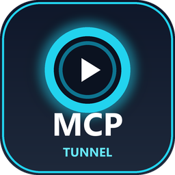
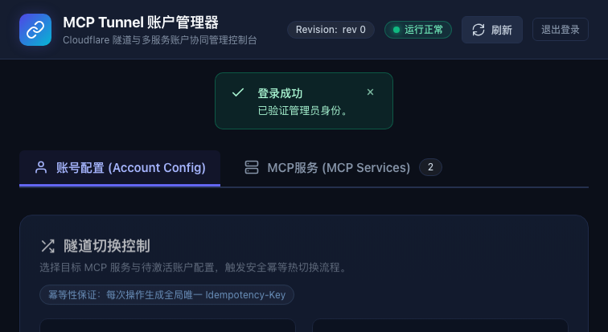
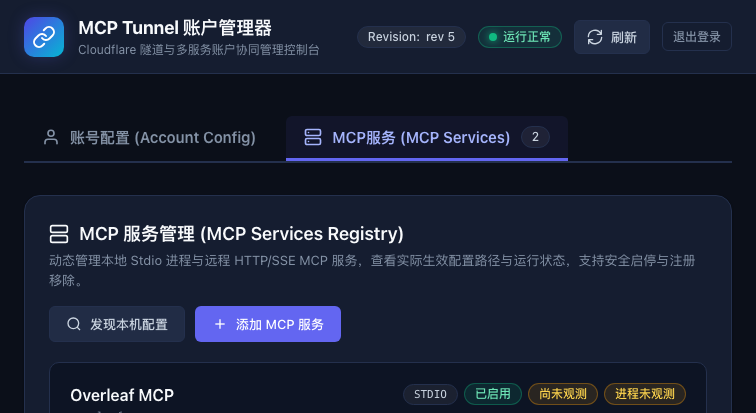
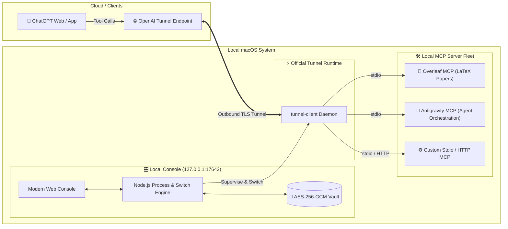

# 🚀 MCP Tunnel Account Manager

<div align="center">

<p align="center">
  
</p>

<p align="center">
  <a href="./README.md">简体中文</a> | <b>English</b>
</p>

**A sleek, zero-dependency, local-first OpenAI Secure MCP Tunnel & Multi-Account Orchestration Console designed for macOS & Windows**

[%20%7C%20Windows-blue.svg?logo=apple&logoColor=white)](https://github.com/diaohuaian/mcp-tunnel-account-manager)
[-green.svg?logo=node.js)](https://nodejs.org)
[](https://github.com/diaohuaian/mcp-tunnel-account-manager)
[-success.svg?logo=github-actions)](https://github.com/diaohuaian/mcp-tunnel-account-manager)
[](https://github.com/diaohuaian/mcp-tunnel-account-manager/stargazers)

<br/>

Seamlessly and securely connect **ChatGPT** to your local MCP servers (**Overleaf LaTeX Collaboration**, **Antigravity AI Agent IDE**, **DeepSeek**, etc.) via **OpenAI Secure MCP Tunnel**, with atomic 5-stage profile switching and automated rollback!

<br/>



</div>

---

## ✨ Why MCP Tunnel Account Manager?

Connecting ChatGPT to local MCP tools on macOS often comes with pain points: **tedious configuration edits**, **process disconnections**, and **risky credential handling across multiple accounts**.

This project provides an out-of-the-box, reliable, and secure orchestration system:

### 🍏 Native macOS Experience
- **Zero PowerShell Dependency**: Completely rewritten with modern Node.js asynchronous architecture for process control and daemon supervision. Native support for **Apple Silicon (M1/M2/M3/M4) and Intel architectures**.
- **One-Click Native Desktop App (with Retina Neon Icon)**: Double-click to silently start the background manager and open your browser console. No lingering terminal windows!
- **macOS System Integration**: Securely stores encrypted databases in `~/Library/Application Support/McpTunnelAccountManager` and supports revealing configuration files in Finder with a single click.

### ⚡ Zero External Dependencies
- Leverages modern Node.js (>= 22.14.0) standard libraries: built-in `node:sqlite` (zero node-gyp or C++ compilation issues), `node:crypto`, native WebSocket, and process supervision.
- **No endless `npm install` needed**—just clone and run!

### 🔒 Local-First Security Vault
- **AES-256-GCM Encryption**: All API keys, Tunnel IDs, and sensitive environment variables are sealed in an encrypted SQLite database using a persistent master key.
- **Strict Permission Isolation**: Secrets and runtime state are restricted to `0600` permissions (accessible only by the current user).
- **Zero Leakage / No Network Exposure**: Strictly bound to loopback `127.0.0.1`, rejecting all public interface exposure and cross-origin attempts.

### 🛡️ 5-Stage Atomic Switch & Automatic Rollback
- Manage multiple account configurations (Profiles) and switch between them on the fly.
- Transaction flow: `QUEUED` $\to$ `PREPARING` $\to$ `APPLYING` $\to$ `VERIFYING` $\to$ `SUCCEEDED`.
- **Zero Drift Protection**: If any health check, PID binding, or tunnel handshake fails during verification, the transaction **automatically rolls back (`ROLLED_BACK`)** to the previous working state.

### 📦 Ready-to-Use Ecosystem Installers
- **OpenAI `tunnel-client` Installer**: Auto-detects Apple Silicon (`darwin-arm64`) vs Intel (`darwin-amd64`), safely downloads the verified v0.0.19 binary, and bypasses Gatekeeper quarantine.
- **Overleaf MCP Installer**: Integrates `mcp-server-overleaf` for real-time LaTeX paper reading, tracked suggestions, diffs, and local compilation.
- **Antigravity MCP Installer**: One-click setup for the [Antigravity MCP](https://github.com/Kio-pon/antigravity-mcp) subagent orchestration engine.

<br/>

<p align="center">
  
</p>

---

## 🏗️ Architecture & Interaction Flow



---

## ⚡ 30-Second Quick Start (macOS)

### 1. Check Prerequisites
Ensure Node.js 22.14.0+ and Git are installed (recommended via Homebrew):
```bash
brew install node git
```

### 2. Clone the Repository
```bash
git clone https://github.com/diaohuaian/mcp-tunnel-account-manager.git
cd mcp-tunnel-account-manager
```

### 3. Install Desktop Shortcut (Recommended 🌟)
Run the desktop shortcut installer to generate a native macOS app with a high-resolution icon:
```bash
./Install-Desktop-Shortcut.sh
```
> 🎉 **Double-click `MCP Tunnel 账户管理器.app` on your Desktop** to automatically start the background daemon and launch the web console in your default browser!

*(Or launch directly from terminal: `./start-manager.sh`)*

---

## 🛠️ Included One-Click Installers

Helper scripts located in `scripts/` automate prerequisites on macOS:

### 1. Install OpenAI `tunnel-client`
```bash
./scripts/install-tunnel-client.sh
```
- Auto-detects Apple Silicon (`darwin-arm64`) vs Intel (`darwin-amd64`).
- Fetches the verified binary from OpenAI, removes quarantine flags, and sets up executables.

### 2. Install Overleaf MCP Server
```bash
./scripts/install-overleaf-mcp.sh
```
- Installs `mcp-server-overleaf` into isolated runtime storage.
- Enables ChatGPT to read sections, review LaTeX papers, and push tracked changes.

### 3. Install Antigravity MCP Server
```bash
./scripts/install-antigravity-mcp.sh
```
- Clones and configures [Antigravity MCP](https://github.com/Kio-pon/antigravity-mcp) for subagent dispatching.

---

## 💻 Common Commands

| Action | Command | Description |
| :--- | :--- | :--- |
| **Start Daemon** | `./start-manager.sh` | Starts background daemon on `127.0.0.1:17642` and opens browser |
| **Stop Daemon** | `./start-manager.sh --stop` | Gracefully shuts down the running daemon process |
| **Foreground Mode** | `./start-manager.sh --foreground` | Runs manager attached to stdout/stderr for debugging |
| **Custom Port** | `./start-manager.sh --port 18000` | Overrides default port 17642 |
| **Run Test Suite** | `npm test` | Runs all 44 test suites (unit, integration, heavy) |

---

## 🔒 Security & Privacy Guarantees

1. **Zero Telemetry**: No analytics, phone-home code, tracking beacons, or third-party requests.
2. **Local-First Credential Isolation**: All master keys, tokens, and database files remain strictly on your local machine (`~/Library/Application Support/McpTunnelAccountManager`). Nothing is ever committed or uploaded.
3. **Defense-in-Depth**: Built-in CSRF protection, session expiration, and atomic Idempotency-Key validation.

---

## 🤝 Contributing

Contributions, issues, and feature requests are welcome!

1. Fork the Project (`git checkout -b feat/amazing-feature`)
2. Commit your Changes (`git commit -m 'feat: Add amazing feature'`)
3. Ensure all tests pass (`npm test`)
4. Push to the Branch (`git push origin feat/amazing-feature`)
5. Open a Pull Request

---

## 🌟 Show Your Support

If this project helps streamline your **ChatGPT + MCP workflow on Mac**, please consider giving it a **⭐️ Star**!

<div align="center">

<a href="https://github.com/diaohuaian/mcp-tunnel-account-manager/stargazers">
  
</a>

</div>
