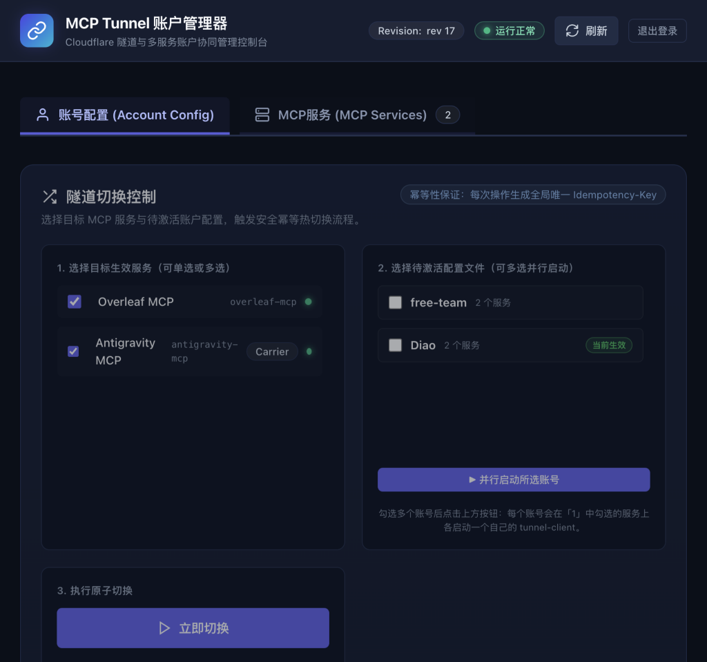

<div align="center">

# 🚀 MCP Tunnel Account Manager

### Cross-Platform (macOS & Windows) Local Management & Concurrency Console for Model Context Protocol (MCP)

[](https://github.com/diaohuaian/mcp-tunnel-account-manager/stargazers)
[](https://github.com/diaohuaian/mcp-tunnel-account-manager/network/members)
[](https://github.com/diaohuaian/mcp-tunnel-account-manager)
[-success?style=for-the-badge&logo=vitest&logoColor=white)](scripts/run-tests.mjs)
[-success?style=for-the-badge&logo=node.js&logoColor=white)](package.json)
[](src/vault.mjs)

<p align="center">
  <b><a href="#-key-features">Key Features</a></b> •
  <b><a href="#-quick-start-macos">macOS Quick Start</a></b> •
  <b><a href="#-quick-start-windows">Windows Quick Start</a></b> •
  <b><a href="#-technical-architecture">Architecture</a></b> •
  <b><a href="#-faq--troubleshooting">FAQ</a></b> •
  <b><a href="README.md">中文文档</a></b>
</p>

> 💡 **If this project saves you from tedious MCP tunnel configurations and process debugging on macOS or Windows, please star ⭐ and fork 🍴 this repository!**

---



</div>

---

## 🌟 Why MCP Tunnel Account Manager?

When working with OpenAI Tunnel Client and multiple MCP (Model Context Protocol) servers on a daily basis, developers frequently encounter these pain points:
- **Painful Multi-Account Switching**: Personal, team, and testing accounts have separate Tunnel IDs, API Keys, and YAML files scattered across the system, making manual edits error-prone.
- **Lack of macOS / Linux Support**: Upstream tools heavily rely on Windows PowerShell, `cmd.exe`, and Windows registry conventions, failing immediately on macOS with `spawn powershell ENOENT`, missing `$HOME`, or path resolution errors.
- **Difficult Multi-Service Concurrency**: Running multiple MCP services simultaneously (e.g. Overleaf writing, Antigravity Agent, custom HTTP/Stdio MCP servers) lacks unified supervision, leading to port conflicts, orphaned processes, or resource crashes.
- **Troublesome Failure Recovery**: Tunnel drops or expired credentials often cause silent desynchronization, requiring tedious manual process hunting.

**MCP Tunnel Account Manager** solves all of these problems by providing a **purely local, zero-dependency, intuitive graphical web dashboard**. It delivers seamless multi-account profile switching, concurrent multi-instance orchestration, encrypted credential storage, and automated health monitoring.

---

## ✨ Key Features

### 🍏 Deep macOS Native Adaptation
- **Zero PowerShell Dependency**: Custom pure Node.js process controller replaces legacy Windows PowerShell dependencies, natively supporting atomic `Inspect`, `Verify`, `Stop`, and `Launch` actions on macOS.
- **POSIX & macOS Standards**: Follows macOS conventions (`~/Library/Application Support`), handles `/var` to `/private/var` symlinks, and safely isolates POSIX environment variables.
- **One-Click Native Desktop App**: Includes `Install-Desktop-Shortcut.sh` to generate a native macOS `.app` bundle directly on your Desktop and in Applications—launch with a single double-click!

### 🛡️ Enterprise-Grade Local Security
- **At-Rest Hardware Encryption**: All sensitive credentials (Tunnel IDs, OpenAI API Keys) are encrypted using AES-256-GCM with master key sealing and AAD tamper protection.
- **Strict Loopback Binding**: Web console strictly listens on `127.0.0.1`, rejecting any external network requests, backed by CSRF token protection and administrator authentication.
- **Recovery Gate Self-Healing**: Features atomic CAS (Compare-And-Swap) drift protection and a safety recovery gate. Any abnormal termination triggers locked isolation and provides one-click reset without process leaks.

### ⚡ Concurrent Multi-Instance & Multi-MCP Orchestration
- **Instant Account Switching**: Define named profiles (e.g., `Work-Team`, `Personal`, `Diao`), and switch active credentials across all services with one click.
- **Arbitrary MCP Registration**: Supports built-in Overleaf MCP and Antigravity MCP, plus arbitrary custom **Stdio** or **HTTP** MCP servers through the web UI.
- **Intelligent Resource Admission (ResourcePolicy)**: Tailored for macOS `vm_stat` paging, measuring active, inactive, and cached memory to prevent resource starvation during burst tunnel launches.

---

## 🚀 Quick Start (macOS)

### 1. Prerequisites
- **macOS**: macOS Ventura (13+), Sonoma (14+), or Sequoia (15+) (supports Apple Silicon M1-M4 & Intel x86_64)
- **Node.js**: `>= 22.14.0` (Install via [Homebrew](https://brew.sh): `brew install node`)
- **Git**

### 2. Clone and Setup
```bash
# Clone repository
git clone https://github.com/diaohuaian/mcp-tunnel-account-manager.git
cd mcp-tunnel-account-manager

# Grant execution permissions
chmod +x *.sh *.command bin/*
```

### 3. Launching the Console

Choose whichever method you prefer:

#### Option A: Install Native Desktop App (Recommended)
```bash
./Install-Desktop-Shortcut.sh
```
A native application **`MCP Tunnel 账户管理器.app`** will appear on your Desktop. Double-click it to start the daemon and open your browser automatically!

#### Option B: Double-Click Command
Double-click **`Start-Console.command`** in Finder.

#### Option C: Terminal Command
```bash
# Start background daemon (recommended)
./start-manager.sh

# Or start in foreground
./start-manager.sh --foreground
```

Open your browser at: **`http://127.0.0.1:17642`**

> 🔑 **First-Time Setup**:
> On first run, the console prompts for a Bootstrap Code. Find it at:
> `~/Library/Application Support/McpTunnelAccountManager/bootstrap-code.txt`
> Paste the code into the web UI to configure your administrator password.

#### Stopping the Console
```bash
./start-manager.sh --stop
```

---

## 🖥️ Quick Start (Windows)

1. Prerequisites: Windows 10 / 11 x64, Node.js >= 22.14.0.
2. Double-click **`Install-Components.cmd`** to install dependencies.
3. Double-click **`Start-Console.cmd`** to open `http://127.0.0.1:17643` in your default browser.
4. Stop the console anytime by double-clicking **`Stop-Console.cmd`**.

---

## 🛠️ Technical Architecture

Built as a layered, modular ESM architecture with zero build-step overhead:

```
mcp-tunnel-account-manager/
├── bin/                          # Cross-platform shims & wrappers
│   ├── powershell                # Pure Node.js process-control bridge for macOS
│   └── antigravity-mcp           # Local Agent bridge CLI
├── public/                       # Zero-bundler native Web UI
│   ├── app.js                    # Multi-MCP registry, profile switching, health observer
│   ├── app.css                   # Modern dark/light responsive styling
│   └── index.html
├── scripts/
│   ├── process-control.mjs       # Native macOS process lifecycle supervisor
│   ├── run-tests.mjs             # High-concurrency isolated test engine
│   └── launch-manager.mjs        # Production launcher with self-contained path resolution
├── src/
│   ├── adapters/                 # Adapter layer (Tunnel lifecycle, protocol abstractions)
│   │   ├── instance-adapter.mjs  # Instance isolation & path canonicalization
│   │   ├── ps-worker-pool.mjs    # Bounded process-control worker pool
│   │   └── tunnel-probe.mjs      # Live HTTP & protocol verification probe
│   ├── core/                     # Core business logic
│   │   ├── resource-policy.mjs   # Intelligent memory admission & concurrency controller
│   │   ├── switch-core.mjs       # Atomic CAS profile switching & rollback engine
│   │   └── daemon-lock.mjs       # Kernel-level singleton mutex lock
│   ├── store.mjs                 # SQLite state store (node:sqlite)
│   ├── vault.mjs                 # Hardware-sealed AES-256-GCM vault
│   ├── server.mjs                # Hardened loopback HTTP server & API routes
│   └── main.mjs                  # Application orchestrator
├── Start-Console.command         # Native macOS double-clickable script
├── Install-Desktop-Shortcut.sh   # Desktop app bundle builder
└── start-manager.sh              # Background daemon lifecycle manager
```

---

## 🧪 Comprehensive Automated Testing

The automated test suite verifies store operations, credential encryption, atomic switching, network probes, failure injection, concurrent instances, and boundary isolation:

```bash
node scripts/run-tests.mjs --unit
```

**Test Execution Results:**
```text
================================================================
Test Execution Summary:
  Total Files:  64
  Passed Files: 64
  Failed Files: 0
  Duration:     15.4s
  Exit Code:    0
================================================================
```

---

## ❓ FAQ & Troubleshooting

<details>
<summary><b>Q: What should I do if "Recovery Gate Triggered (NEEDS_ATTENTION)" appears?</b></summary>

This is an automated safety mechanism designed to prevent split-brain states or port pollution when target verification fails.
- **Resolution**:
  1. Verify your local proxy (e.g. Clash, Surge) is running (default port is `127.0.0.1:7897`).
  2. Verify that your Tunnel ID and OpenAI API Key in the active profile are valid.
  3. Click **"Reset Recovery Gate"** on the banner to clear the lock and re-apply cleanly.
</details>

<details>
<summary><b>Q: How do I change the default port or data directory on macOS?</b></summary>

You can configure them via environment variables or CLI options:
```bash
PORT=18000 DATA_DIR="$HOME/custom-mcp-data" ./start-manager.sh
```
</details>

<details>
<summary><b>Q: How can I register a custom MCP server?</b></summary>

In the web dashboard under **"MCP Services"**, click **"Add MCP"**:
- **Stdio Mode**: Specify the executable command, arguments, and working directory.
- **HTTP / SSE Mode**: Provide the upstream MCP server HTTP URL and headers.
- Once saved, assign a tunnel and credential to it in **"Account Configuration"** to run it concurrently.
</details>

---

## 🤝 Contributing

Contributions, issues, and feature requests are welcome!
1. Fork the Project
2. Create your Feature Branch (`git checkout -b feature/amazing-feature`)
3. Commit your Changes (`git commit -m 'feat: add amazing feature'`)
4. Push to the Branch (`git push origin feature/amazing-feature`)
5. Open a Pull Request

---

## 📄 License

Distributed under the [MIT License](LICENSE).

---

<div align="center">

**🌟 If this project helped you, please consider giving it a Star ⭐!**

[Back to Top ⬆️](#-mcp-tunnel-account-manager)

</div>
